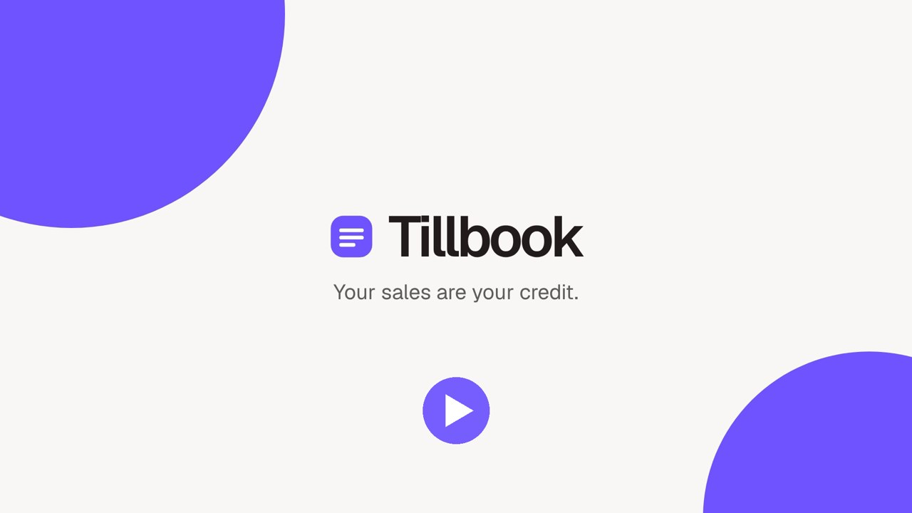
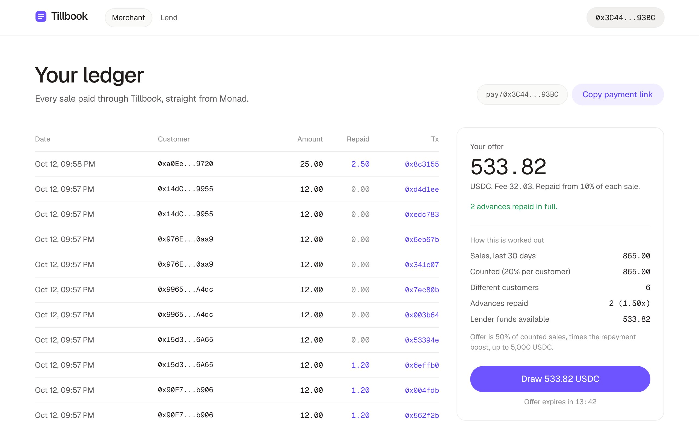
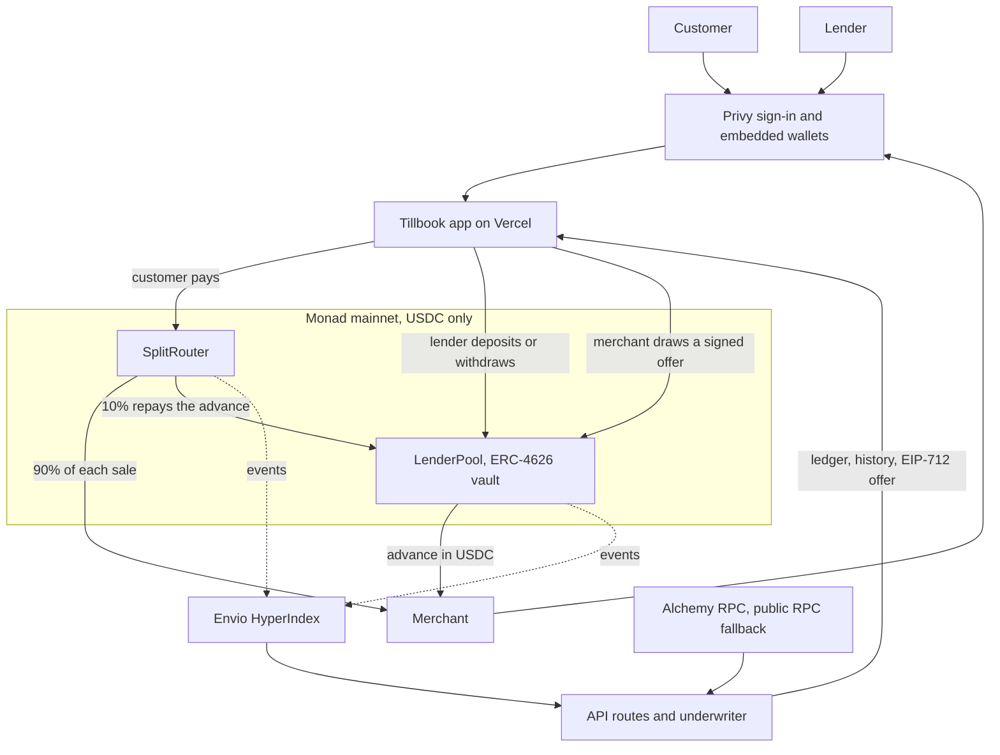
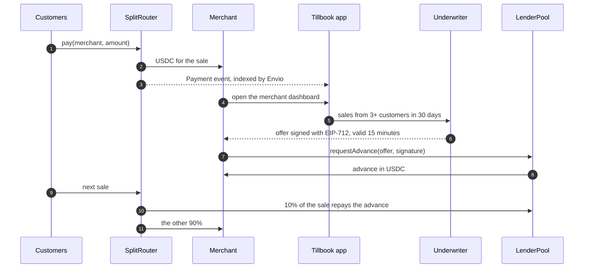

# Tillbook

**Your sales are your credit.** Tillbook is onchain revenue-based financing for small merchants. Merchants take USDC stablecoin payments on Monad, every sale builds a credit record the merchant owns, and the pool funds an advance against it. A slice of each later sale repays the advance in the same transaction, so repayment follows real revenue instead of a fixed daily debit.

**[Open the app](https://tillbook.midelabs.xyz)** · [Demo video](https://youtu.be/NW-j5vx6bFw) · [Docs](https://tillbook.midelabs.xyz/docs) · [Contracts on Monadscan](https://monadscan.com/address/0x317E89b89aeE6af8c1fD6AaceF06daaD733EFFaE) · [CI](https://github.com/mystiquemide/tillbook/actions) · [X @tillbook_xyz](https://x.com/tillbook_xyz)

**Try it in 60 seconds:** [pay a live merchant 0.10 USDC](https://tillbook.midelabs.xyz/pay/0x0D3F699A73D6971e21eFF191Dc15536b48EFC444?amount=0.1) with just an email sign-in. That merchant has an open advance, so 10% of your payment repays it inside the same transaction. You need 0.10 USDC and a little MON on Monad.

[](https://youtu.be/NW-j5vx6bFw)



## At a glance

| | |
|---|---|
| **Category** | Onchain finance: payments, lending and credit (Monad Metropolis, Track 01: Onchain Finance & Trading) |
| **Status** | Live on Monad mainnet with verified contracts. The first real advance was drawn from real sales and is repaying ([see below](#live-on-mainnet)) |
| **Who it serves** | Small merchants who need working capital, customers who pay in USDC, and lenders who want yield backed by real sales |
| **How lenders earn** | A flat 6% fee on each advance, paid into the ERC-4626 vault slice by slice as merchants make sales |
| **Core contracts** | `SplitRouter` (payment split) and `LenderPool` (ERC-4626 vault with EIP-712 signed offers) |
| **Integrations** | Monad, USDC, OpenZeppelin, Privy embedded wallets, Envio HyperIndex, Alchemy RPC, built with Solidity, Foundry, viem, wagmi and Sourcify |
| **For newcomers** | Email or Google sign-in, a built-in wallet with send, receive and key backup, and a 2-minute interactive walkthrough at [`/start`](https://tillbook.midelabs.xyz/start) |
| **Quality** | 1,336 automated tests including fuzz, invariant and mainnet-fork tests, run in CI on every push |
| **Try it** | [tillbook.midelabs.xyz](https://tillbook.midelabs.xyz) · [Docs](https://tillbook.midelabs.xyz/docs) · [Live proof page](https://tillbook.midelabs.xyz/proof) |

## Live on mainnet

A full loop ran on Monad mainnet with real USDC: one lender, one merchant, three different customers.

| Step | Transaction |
|---|---|
| Lender deposits 2 USDC into the pool | [`0x01ab63...2050`](https://monadscan.com/tx/0x01ab631cb550ad8508d11272b3955417d87c9e3da4631e8b89a3f049e2902050) |
| Customer 1 pays the merchant 0.50 | [`0x490c08...e6`](https://monadscan.com/tx/0x490c08e9ddc35d9ba935996d004dff0906bab4539a0124597d4e150ef576d2e6) |
| Customer 2 pays 0.50 | [`0xc98d85...61`](https://monadscan.com/tx/0xc98d8594098110b852dec078a5145badc4941819b168abe0a610311ec7b9ad61) |
| Customer 3 pays 0.50 | [`0x890922...fc`](https://monadscan.com/tx/0x890922bcd80e8b798e233d959bcde8ee1ce1b352ec87a515f09955ca3aa8bbfc) |
| Merchant draws a signed advance | [`0xc73669...7d`](https://monadscan.com/tx/0xc73669cc7b3645e04181219c87ca295f0cb7f8854e55fa3001fa21a080926d7c) |
| A later sale repays 10% to the pool in the same payment | [`0xe53c35...50`](https://monadscan.com/tx/0xe53c3535e7f400696bce88f376fa10c8e0305e5a8dda1d14003dcb1f80f2fd50) |

## Try it yourself

You need a little MON for fees and some USDC on Monad. Small amounts are enough.

1. **Lend.** Sign in at `/lend`, enter an amount, check the review and deposit. You confirm twice: allow USDC, then deposit.
2. **Get paid.** Sign in with a second account at `/merchant` and copy your payment link or QR code.
3. **Collect sales.** Pay that link from three different wallets. Your own payments don't count.
4. **Draw.** Back on `/merchant`, the offer appears with every input shown. Draw it and the USDC lands in your wallet.
5. **Repay by selling.** Pay the link again and watch "Still owed" drop by 10% of the sale.
6. **Check the wallet.** `/wallet` shows each step labelled in Activity.

## New to crypto? Start here

Open [tillbook.midelabs.xyz/start](https://tillbook.midelabs.xyz/start). It's a hands-on walkthrough with no jargon:

1. **The idea.** What Tillbook does for a shop, in one paragraph.
2. **Try it.** Run a pretend shop: take sales, unlock an offer, draw it and watch 10% of each sale pay it down. The offer uses the same formula the live underwriter signs with.
3. **Who does what.** What a shop owner, a customer and a lender each do, step by step.
4. **Words you'll see.** Wallet, USDC, MON, confirm, address, advance and pool in plain words.
5. **Get started.** Pick a role and follow a checklist that ticks itself off from your real wallet: signed in, MON for fees, USDC, first action.

Signing in with email or Google creates a wallet for you. The walkthrough stays one click away in the account menu.

## Why this exists

Small merchants get financing from whoever processes their payments, and the decision is a black box.

- A Shopify merchant who had repaid over £500,000 was refused £180,000 with no reason given. ([r/shopify](https://www.reddit.com/r/shopify/comments/1pyn2ic/shopify_capital_rejected_no_reason_provided_after/))
- A Stripe Capital offer fell from about $35,000 to $6,000 while the merchant's revenue grew. ([r/stripe](https://www.reddit.com/r/stripe/comments/1p1g2sb/stripe_capital_new_offer_update/))
- Merchant cash advances take fixed daily debits whether the shop sold anything that day or not.

The merchant's repayment history is locked inside one platform, so they can't take it anywhere else. Tillbook keeps that history onchain, where the merchant owns it and can share it with any lender. The result is transparent underwriting, portable credit and capital that flows to merchants based on what they actually sell, without Tillbook ever displaying anyone's balances.

## How it works

```
Customer ──pay()──► SplitRouter ──10% while an advance is open──► LenderPool
                         └──────────────── the rest ────────────► Merchant

Lender ──deposit──► LenderPool ──advance──► Merchant   (offer signed by the underwriter)
```

1. **Get paid.** Customers pay through the merchant's link or QR code. `SplitRouter` sends the USDC and emits a `Payment` event.
2. **Get an offer.** The underwriter reads those events and prices an advance with a public formula. The merchant sees every input.
3. **Draw it.** The merchant submits the signed offer to `LenderPool` and the USDC lands in their wallet.
4. **Repay as you sell.** While the advance is open, 10% of each sale goes to the pool inside the same payment. Slow day, small repayment. No sales, no repayment. There are no debits and no due dates.
5. **Grow.** Each advance repaid in full raises the next offer, up to 2×.

Lenders deposit USDC into the pool, earn the 6% fee as merchants repay, and can withdraw anything that isn't lent out at any time.

### The offer formula

```
eligible   at least 3 different customers in the last 30 days, own payments excluded
volume     each customer counts for at most 20% of the total, so a few large payers can't inflate it
amount     min(volume × 50% × boost, 5,000 USDC, free pool liquidity)
boost      1 + 0.25 per advance repaid in full, up to 2×
fee        6% of the amount, flat
holdback   10% of each sale until repaid
expiry     15 minutes
```

Source: [`underwriter/src/formula.ts`](underwriter/src/formula.ts). The same numbers appear in the app under "How this is worked out".

## What you can do in the app

| Page | For | What it does |
|---|---|---|
| [`/`](https://tillbook.midelabs.xyz) | Everyone | What Tillbook is and how it works |
| [`/start`](https://tillbook.midelabs.xyz/start) | Newcomers | Interactive walkthrough and a live first-transaction checklist |
| [`/merchant`](https://tillbook.midelabs.xyz/merchant) | Merchants | Sales ledger, current offer and the math behind it, draw an advance, amount still owed, payment requests with QR codes and sharing, CSV export |
| `/pay/[merchant]` | Customers | Checkout. Shows exactly how the payment splits before you confirm. `?amount=25.50` pre-fills a requested amount |
| [`/lend`](https://tillbook.midelabs.xyz/lend) | Lenders | Deposit and withdraw with a review step before each one, your position and earnings, and every advance with its repayment status |
| [`/wallet`](https://tillbook.midelabs.xyz/wallet) | Everyone signed in | Balance in dollars, send USDC or MON, receive by QR, labelled activity history, private key export for email wallets |
| `/m/[merchant]` | Lenders | Public sales record of one merchant and how their offer is priced |
| [`/proof`](https://tillbook.midelabs.xyz/proof) | Anyone | Live checks against the mainnet contracts, tests and measured gas |
| [`/risks`](https://tillbook.midelabs.xyz/risks) | Anyone | What can go wrong, in plain words |

Nothing in the app is mock data. Balances, offers and history are read from Monad, and empty states say so plainly.

### Wallet

After signing in, `/wallet` works like a banking app:

- **Balance** in dollars: USDC plus your lending deposit, with MON shown separately for network fees.
- **Send** USDC or MON with a review step. It blocks invalid addresses, your own address, Tillbook's contract addresses and amounts above your balance, and keeps enough MON for the fee.
- **Receive** with a QR code, a copy button and a warning to use the Monad network only.
- **Activity** from onchain USDC transfers since launch, each labelled from Tillbook events in the same transaction: payment, sale (with the part that repaid an advance), deposit, withdrawal, advance, sent or received.
- **Backup.** Wallets Privy created at sign-in can export their private key after a fresh sign-in and an explicit warning. The key opens in Privy's isolated window, so Tillbook's code never sees it. Browser wallets keep their keys and the page says where to back them up.

### Privacy

Tillbook doesn't publish pool size, lender balances or advance amounts on its pages. The advances list shows only each advance's number and whether it's repaid, and the API returns nothing more. Merchants choose to share their sales record through `/m/[address]`. Monad is a public chain, so the contracts' events can still be read on an explorer.

## Architecture



How an advance happens, end to end:



- **Contracts** hold all funds and enforce every rule. The underwriter can only sign offers, which the pool checks against a hard cap, one open advance per merchant, a nonce and an expiry.
- **The app** reads history from Envio when the indexer is caught up and falls back to scanning chain logs. Contract reads go through Alchemy with the public RPC as backup.
- **Wallets** come from Privy for email and Google sign-in, or any browser wallet. Keys never pass through Tillbook's servers.

## Why Monad

The repayment happens inside each customer payment, so every sale is a contract call. That only works if paying through the contract feels like paying normally.

- **Fast enough for a checkout.** On Monad a payment that also repays an advance confirms before the customer looks up from their phone. The app shows the measured time on every receipt.
- **Cheap enough for small tickets.** A plain payment costs 67,096 gas and a payment that also repays costs 119,601, so a 5 USDC coffee can carry its own repayment.
- **Native USDC.** Everything settles in Circle's USDC on Monad mainnet, so merchants and lenders hold a real dollar asset, not a wrapped one.
- **Parallel-friendly by design.** Payments to merchants without an open advance only touch the token balances of payer and merchant. The router has no shared counters, so unrelated payments don't contend for the same storage.

## Built with

| | How Tillbook uses it |
|---|---|
| **Monad** | Mainnet, chain 143. Every sale is a contract call, so speed and gas cost decide whether in-sale repayment works at all. |
| **USDC** | Circle's native USDC is the only asset the pool and router accept. |
| **OpenZeppelin** | ERC-4626 vault, EIP-712 offer signatures, SafeERC20 and reentrancy guards in `LenderPool`. |
| **Privy** | Email, Google or wallet sign-in. People without a crypto wallet get an embedded Monad wallet when they sign in, so a customer can pay from a link without installing anything. Embedded wallets can export their key from `/wallet` after a fresh sign-in. |
| **Envio** | A HyperIndex indexer ([`indexer/`](indexer)) tracks payments, advances, repayments and lender flows. The app reads history from it whenever it's caught up to the chain head, and falls back to scanning logs otherwise. |
| **Alchemy** | Server-side contract reads and offer pricing go through Alchemy's Monad RPC, with the public RPC as automatic fallback. |
| **Toolchain** | Solidity and Foundry for the contracts and their tests, viem and wagmi in the app and underwriter, Sourcify for source verification. |

## Deployed on Monad mainnet

Source verified on Sourcify.

| Contract | Address |
|---|---|
| LenderPool | [`0x317E89b89aeE6af8c1fD6AaceF06daaD733EFFaE`](https://monadscan.com/address/0x317E89b89aeE6af8c1fD6AaceF06daaD733EFFaE) |
| SplitRouter | [`0x380A8e5A6BbE708E17397f3c31Cb806bfd920853`](https://monadscan.com/address/0x380A8e5A6BbE708E17397f3c31Cb806bfd920853) |
| Underwriter signer | `0x77fB8bc19CB9fc116701b23309287b2d8F577A4A` |
| USDC | `0x754704Bc059F8C67012fEd69BC8A327a5aafb603` |

Chain 143. Pool deploy block 112997981. Advance cap 5,000 USDC, fixed at deploy.

| Contract | Role |
|---|---|
| [`LenderPool`](contracts/src/LenderPool.sol) | ERC-4626 USDC vault. Pays advances against EIP-712 offers and takes repayments. Fees reach lenders as repayments arrive. Withdrawals are limited to liquidity that isn't lent out. |
| [`SplitRouter`](contracts/src/SplitRouter.sol) | Splits each payment between the merchant and the pool. Holds no funds and has no owner. |

## Security model

- **No admin keys.** No owner, no pause, no upgrades. Funds move only by the contract rules.
- **The underwriter can only sign offers.** It can't move pool funds. Each offer is bound to one merchant, one pool and one chain, can be used once, and expires in 15 minutes. Only the named merchant can draw it.
- **Hard cap.** No advance can exceed 5,000 USDC, enforced onchain, which bounds the damage from a leaked signing key.
- **One open advance per merchant.** A new one can't be drawn until the last is repaid.
- **Inflation-resistant vault.** The pool uses a 6-decimal share offset against the first-depositor attack.
- **The router checks its own work.** It refuses payments to the pool or router address and verifies the pool's repay result.

## Testing

| Suite | Count |
|---|---|
| Solidity unit, guard and parity tests | 102 |
| Solidity fuzz tests (1,000 runs each) | 20 |
| Solidity invariant tests (256 runs × 64 calls) | 7 |
| Mainnet fork tests against live USDC | 2 |
| TypeScript underwriter tests | 1,202 |
| Envio indexer handler tests | 3 |

What matters more than the count: invariants prove pool solvency and share accounting hold under random sequences of deposits, advances, repayments and withdrawals, and the parity suite proves that offers signed by the TypeScript underwriter produce the same EIP-712 digest in Solidity and are accepted by `requestAdvance`, and that the app's split preview matches the router exactly.

CI runs all of it on every push, along with lint, typecheck and a production build of the app.

### Measured on a Monad mainnet fork with live USDC

| Action | Gas |
|---|---|
| Payment, no advance | 67,096 |
| Payment that also repays an advance | 119,601 |
| Draw an advance | 153,643 |
| Lender deposit | 74,005 |

## Repository

```
contracts/     Solidity (Foundry): LenderPool, SplitRouter, tests, deploy script
underwriter/   TypeScript: offer formula, EIP-712 signing, event reader, seed script
indexer/       Envio HyperIndex: schema, event handlers and tests
web/           Next.js app: landing, merchant, checkout, lender, record and proof pages
```

## Run it

```bash
# contracts
cd contracts && forge test
MONAD_FORK=true forge test --match-path 'test/fork/*'

# underwriter
cd underwriter && npm install && npm test

# indexer
cd indexer && pnpm install && pnpm codegen && pnpm test

# app (reads the mainnet contracts above)
cd web && npm install
cp ../.env.example .env.local   # add UNDERWRITER_PRIVATE_KEY to enable signed offers
npm run dev
```

Deploying your own instance:

```bash
cd contracts
UNDERWRITER_ADDRESS=0x... forge script script/Deploy.s.sol \
  --rpc-url https://rpc.monad.xyz --broadcast --private-key $DEPLOYER_PRIVATE_KEY
```

The script refuses to run on any chain except Monad mainnet and checks that the token is 6-decimal USDC.

## Limitations

- A merchant can take payments outside the router after drawing. That can't be blocked onchain, but it shows in their public history and their next offer drops.
- Lenders carry default risk. There's no collateral or collections, and the pool absorbs losses.
- The underwriter is a single signing key. The onchain cap limits what it can do.
- No KYC. A regulated version would need it.
- Someone who deposits right before a large repayment can capture part of its fee. Fees arrive in small slices with each sale, which keeps this small.

## Business model

- **Lenders** earn the 6% advance fee. Returns come from real merchant revenue, not token emissions.
- **Merchants** pay nothing to accept payments. They only pay the flat fee when they choose to draw an advance.
- **Tillbook** can take a small protocol fee on advance fees once the pool has volume. The contracts have no fee switch today, so any fee would ship as a new, openly versioned pool.

## Where this goes next

- **Point-of-sale plugins** so existing card-and-QR checkouts can route USDC through the split without a new app.
- **Decentralized underwriting** by running the offer formula as a Chainlink CRE workflow, which removes the single signing key.
- **More stablecoins**, starting with AUSD, through a second pool per asset. The contracts already take the token as a constructor argument.
- **Multiple underwriters and pools** competing on price for the same merchant record.
- **Portable credit history** other protocols can read, so a merchant's record works beyond Tillbook.

## Prior art

[Credit Coop](https://www.visa.com/en-us/thought-leadership/innovation/onchain-settlement-financing) uses a similar repayment lockbox to fund card programs such as Rain. Tillbook brings the idea to individual merchants and makes the underwriting inputs public.

## License

MIT
